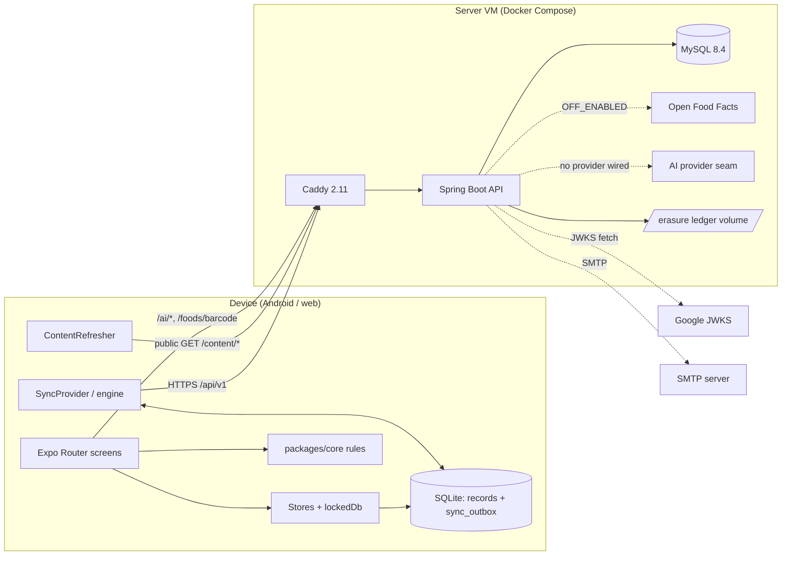
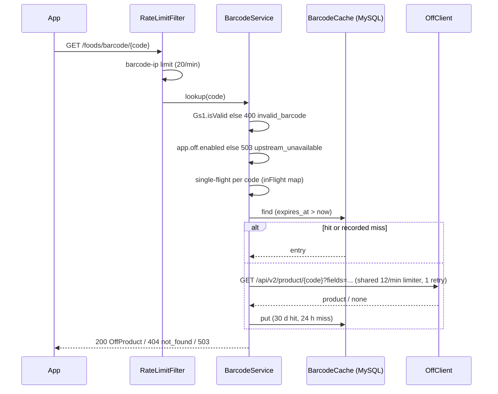
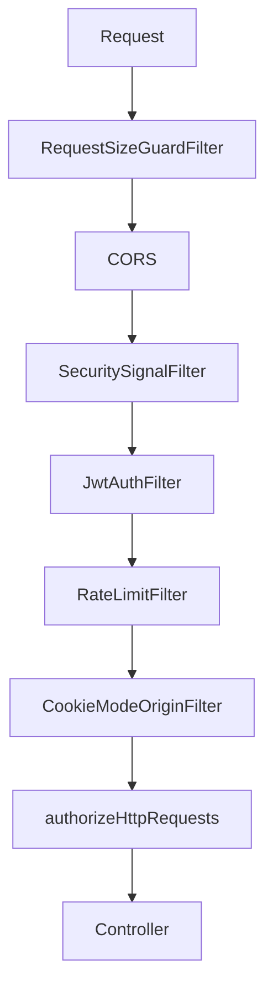
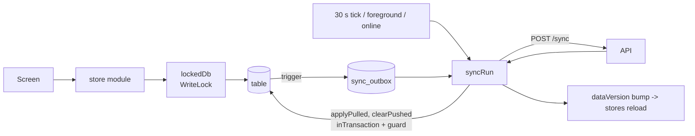
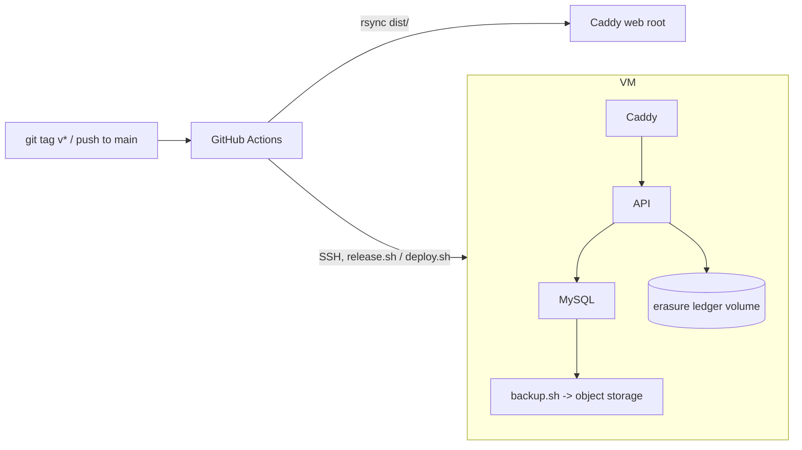

# Plate & Bar: Low-Level Design

Describes the code as it is on branch `design-overhaul` (cut from `main` at `a856fe0d`, then `1a6210d1`). The repository is the source of truth; where this document and the code differ, the code wins.

**Depth of coverage.** The backend (`backend/`) was read class by class and is documented in detail. The mobile app (`apps/mobile`) was read at the architecture level: routing, database, write path, sync engine, token handling, content refresh. Individual screens, the workout module (37 files), the native modules, the pose/barcode/label-scan code, `apps/site`, `tools/` and `content/` were surveyed but not traced; they are described only as far as the evidence in section 3 supports. Statements are marked **[inferred]** when they follow from the code but are not stated in it, and **[not identifiable]** when the code read did not settle them.

---

## 1. Overview

### Purpose
Plate & Bar is an offline-first fitness and nutrition app: targets, a workout plan engine with progression, food and recipe logging, progress tracking and optional AI helpers. It runs on Android and web from one Expo codebase (iOS is declared in `app.json` but is a later target, per `HANDOFF.md`).

### Scope of this document
Monorepo components:

| Component | Path | Role |
|---|---|---|
| Mobile/web app | `apps/mobile` | Expo SDK 58 app, SQLite store, sync client |
| Rules library | `packages/core` | Pure TypeScript rules ported from the prototype |
| API contract | `packages/api` | `openapi.yaml` (0.1.26), generated client, test vectors |
| Backend | `backend` | Spring Boot API: auth, sync, account rights, AI proxy, barcode proxy, content |
| Content | `content/*.json` | Exercise, food, recipe, card, lab data bundles |
| Content tools | `tools/` | Importers, validators, golden-fixture generator |
| Website | `apps/site` | Astro site: landing, privacy, terms, deletion, licences, blog |
| Infra | `infra/`, `.github/workflows/` | Compose stack, Caddy, CI, deploy, backup, monitoring |
| E2E | `tests/e2e` | Playwright (web) and Maestro (Android) |
| Prototype | `docs/prototype/plate-and-bar.html` | Behavioural reference for the rules |

### Responsibilities split (observed)
- **The server stores, syncs and guards; every rule runs on the device.** The contract header says this and the backend contains no targets, plan or progression logic (`openapi.yaml` info text; backend package list in section 3).
- **Core is the only place numbers and rules live**; the app imports it (`docs/AGENTS.md` lane rules; `metro.config.js` watches `packages/core`).
- **The contract is the single shared artefact**: the backend reads it at runtime for sync validation (`SyncRequestValidator` loads `/openapi.yaml` from the classpath), the app uses a client generated from it, and tests validate real responses against it.

### Out of scope / not built
- `GET /foods` (food search) is in the contract but has no controller. The contract tests allowlist exactly this operation (`backend/README.md`, "Contract tests"; #200 decision 2). Food search runs on the device.
- No production AI provider exists in `backend/src/main`. The only `AiProvider` implementation is `StubAiProvider`; see section 10.
- iOS release, device step counting (deferred to v1.1 per `HANDOFF.md`), push reminders on a server (reminders are a local module).

### High-level architecture



---

## 2. Technology Stack

Confirmed from `build.gradle`, `package.json` files, `app.json`, `docker-compose.yml`.

| Layer | Technology |
|---|---|
| Backend | Java 21, Spring Boot **4.1.1** (Spring Framework 7, Spring Security 7, **Jackson 3** `tools.jackson.*`), Gradle (wrapper), `spring-boot-starter-webmvc`, `-security`, `-validation`, `-jdbc`, `-mail`, `-flyway` |
| DB access | `JdbcTemplate` with hand-written SQL (no JPA/ORM) |
| Database | **MySQL** (`mysql:8.4.11` in Compose), Flyway migrations `V1`..`V10`, `mysql-connector-j` |
| Auth libs | `spring-security-oauth2-jose` (Nimbus JOSE) for HS256 access JWTs and Google JWKS verification |
| Rate limiting | Bucket4j 8.21 (in memory) behind a bounded Caffeine cache |
| Contract validation | `com.networknt:json-schema-validator` 3.0.8 + Jackson YAML |
| Error tracking | `sentry-spring-boot-4` 8.61.0, off unless `SENTRY_DSN` is set |
| Backend tests | JUnit 5, Spring test slices, Testcontainers MySQL, GreenMail (SMTP), OkHttp MockWebServer (fake Open Food Facts) |
| App | Expo SDK 58, React Native 0.88, React 19.3, Expo Router 58 (`asyncRoutes: false`, single web bundle), TypeScript, `expo-sqlite` (wa-sqlite wasm on web), `expo-secure-store`, `@sentry/react-native`, Jest 30 |
| On-device ML/OCR | tesseract.js (web) and Tesseract4Android (native) for label scan, TensorFlow.js + MoveNet for pose, ZXing for barcodes (versions in `apps/mobile/package.json`; ADR 010) |
| Core | TypeScript, Jest (+ `@swc/jest`) |
| Site | Astro 7 |
| Edge / hosting | Caddy 2.11.7 reverse proxy, Docker Compose (`mysql`, `api`, `caddy`) |
| CI | GitHub Actions (`ci.yml` plus deploy, release, security and scan workflows) |
| E2E | Playwright (Chromium via `@puppeteer/browsers`), Maestro flows, axe-core |

Note: the generic stack description in `~/.claude/CLAUDE.md` (Maven, Postgres, Datastore, Redis, Pub/Sub, Elasticsearch) does **not** match this repository. There is no Maven, Postgres, Redis, messaging system or Elasticsearch here.

---

## 3. Module / Package Structure

### 3.1 Backend `app.plateandbar.api` (203 Java files incl. tests; ~8.2k main lines)

| Package | Responsibility |
|---|---|
| `(root)` `Application` | Spring Boot entry point |
| `auth` | Sign-in (Google, email code), JWT issue/verify, refresh rotation, cookie mode, security filter chain, CORS, mail |
| `sync` | `POST /sync` engine, request validation against the contract, export reads, per-account record cap and recount |
| `account` | `GET /me/export` (streamed), `DELETE /me`, erasure ledger |
| `ai` | Seven AI endpoints, quota/budget, prompts, reply parsing, image re-encoding, provider seam |
| `foods` | `GET /foods/barcode/{code}`: Open Food Facts proxy with MySQL cache |
| `content` | `GET /content/manifest`, `GET /content/{bundle}` served byte-for-byte with strong ETags |
| `ratelimit` | In-memory limiter, request filter, client-IP resolution, limit properties |
| `common` | Error model and handler, size-guard filter, security-signal logging filter, CORS properties, clock |
| `health` | `GET /health` |
| `observability` | `SentryScrubber` |

### 3.2 Mobile app `apps/mobile`

| Area | Path | Notes |
|---|---|---|
| Routes | `app/` | `_layout.tsx`, tabs `index` (food), `workout`, `progress`, `targets`; stack screens `setup`, `sign-in`, `data`, `about`, `library`, `recipes`, `kitchen-test`, `meal-plan`, `barcode-dev` |
| Screens | `src/screens/*` | One component per route screen |
| Local DB | `src/db/*` | Migrations, outbox, `lockedDb`, `writeLock`, per-domain store modules |
| Sync client | `src/sync/*` | `engine.ts` (783 lines), `SyncProvider.tsx`, `webSession.ts`, `cookieHealth.ts`, `held.ts`, `quarantine.ts`, `tokens.ts`, `transport.ts` |
| State | `src/state/*` | `ProfileProvider`, `SettingsProvider`, `Gate`, `ViewedDate`, toasts |
| Content | `src/content/*` | `bundled.json`, store, loader, refresh |
| Secure storage | `src/secure/*` | SecureStore token + key helpers |
| Features | `src/{workout,food,ai,barcode,labelscan,pose,photos,cycle,labs,recipes,reminders,steps,...}` | Feature modules (not traced) |
| Native modules | `modules/{device-steps,plate-barcode-scanner,plate-label-scanner,plate-pose,plate-reminders}` | Local Expo modules |
| Build plugin | `plugins/with-no-backup.js` | Android backup off |
| Scripts | `scripts/` | `licences.mjs`, `content-meta.mjs`, `web-reload.mjs`, `test-under-load.mjs`, ... |

### 3.3 Other packages
- `packages/core/src` (about 9.2k lines, ~50 modules): `targets`, `setup`, `plan`, `progression`, `food`, `recipes`, `workout`, `progress`, `stalls`, `mealplan`, `meals`, ... Pure functions; anything date-dependent takes `now` as an argument (`packages/core/README.md`). `package.json` `main` points at `src/index.ts`; the app consumes it as a `file:` dependency and Metro watches it.
- `packages/api`: `openapi.yaml`, `client/{index,schema.d,contract-guards}.ts`, `test-vectors/*.json` + `verify.mjs`.
- `tools/`: `exercises-import`, `foods-import`, `cards-import`, `exercise-figures`, `exercise-motion`, `golden-gen`, `validate/*`, `check-no-ifct`.
- `apps/site/src/pages`: `index`, `privacy`, `terms`, `delete-account`, `licenses`, `blog/`.

---

## 4. Component Design (backend)

### 4.1 Request pipeline

Servlet filters and the Spring Security chain, outermost first (confirmed from `RequestSizeGuardFilter` and `SecurityConfig`):

1. `RequestSizeGuardFilter` (`@Order(HIGHEST_PRECEDENCE+10)`, only `/api/*`). Refuses `Content-Length` over `app.sync.max-body-bytes` (default 2 MB) with 400 `invalid_request` / detail `too_large`; for chunked bodies wraps the stream in a counting stream that throws `TooLarge`.
2. Spring Security CORS processing (`corsConfigurationSource`).
3. `SecuritySignalFilter`: after the chain returns, writes one INFO line per 401/403/429 (logger `app.plateandbar.security`), no IP/user/token/query.
4. `JwtAuthFilter`: bearer token validation (skipped for `/health`, `/auth/**`, `/content/**`, `/foods/barcode/**`).
5. `RateLimitFilter` (after `JwtAuthFilter`).
6. `CookieModeOriginFilter` (after `RateLimitFilter`): CSRF-style Origin check for cookie mode.
7. Controller.

The chain is stateless (`SessionCreationPolicy.STATELESS`), CSRF/form/basic login/logout disabled; the principal is the user id string. The security context is kept on the request via `RequestAttributeSecurityContextRepository` so the ASYNC dispatch of the streamed export is re-authenticated.

### 4.2 `auth`

| Class | Responsibility |
|---|---|
| `AuthController` | `/api/v1/auth/{google,email/start,email/verify,refresh,refresh/revoke}` |
| `AuthService` | Sign-in, code issue/verify, refresh rotation with reuse detection, revoke |
| `JwtService` | HS256 access token, 15 min, issuer `plate-and-bar`, `sub` = user id; expiry checked separately so `token_expired` is distinguishable from a bad signature |
| `JwtAuthFilter` | Verifies token, checks the user still exists (`UserExistenceCheck`), 503 `unavailable` when the DB cannot answer |
| `GoogleIdTokenVerifier` + `AuthConfig` | Google JWKS (RS256 only, 1 h cache, 30 s refetch gap, 2 s timeouts, 51,200-byte cap); issuer, audience (`GOOGLE_CLIENT_IDS`), 60 s skew, `email_verified` required |
| `CookieMode`, `CookieModeOriginFilter`, `CookieModeProperties` | Web refresh-cookie transport (ADR 006) |
| `UserRepository`, `RefreshTokenRepository`, `EmailCodeRepository`, `EmailVerifyFailureRepository` | SQL |
| `MailSender` -> `SmtpMailSender` (`@Profile("!dev")`) / `LoggingMailSender` (`@Profile("dev")`) | Delivery of sign-in codes |

### 4.3 `sync`
`SyncController` (reads the body bounded, parses to a tree) -> `SyncRequestValidator` (JSON-Schema against `SyncRequest` + id/natural-key/duplicate/size rules) -> `SyncService.sync` (transactional engine) -> `SyncRepository` (all SQL). `SyncTable` is the 16-value enum; `Cursor` formats `c_<16 hex>`; `Uuids` computes UUIDv5; `CompactJsonSizes` enforces the contract's `x-max-json-bytes`; `SyncExporter` pages rows for export; `RecordRecount` recomputes `sync_state.records` at start when the cap is on.

### 4.4 `account`
`AccountController` (`/api/v1/me/export`, `DELETE /api/v1/me`), `AccountService`, `AccountRepository`, `ErasureLedger`, `ExportAbortedException`.

### 4.5 `ai`
`AiController` -> `AiService.run` pipeline; `AiQuotaService` + `AiUsageRepository` (quota, budget); `AiSchemas` (request validation from the contract), `AiPrompts`, `AiReplies` (parse/validate model output), `AiContent` (cards, exercises, foods, raw ingredients loaded from the bundled content), `AiImages` (image screening and re-encode), `AiProvider` / `StubAiProvider` / `AiProviderConfig` (auto-configuration, stub only if no other bean).

### 4.6 `foods`
`FoodsController` -> `BarcodeService` -> (`BarcodeCache`, `OffClient`, `OffMapper`, `Gs1`).

### 4.7 `ratelimit`, `common`
See sections 11 and 12.

---

## 5. API Design

Base path `/api/v1`. Errors always use the contract `Error` shape (`{code, message, details?}`), built by `ApiExceptionHandler`. Auth column: **public** = no bearer token is read at all.

| Method | Path | Auth | Purpose | Success |
|---|---|---|---|---|
| GET | `/health` | public | `SELECT 1`; 503 `unavailable` if the DB fails | 200 `{status:"ok"}` |
| POST | `/auth/google` | public | `{id_token}` | 200 `TokenPair` |
| POST | `/auth/email/start` | public | `{email}` | 202 `{code_expires_at, resend_after_seconds}` |
| POST | `/auth/email/verify` | public | `{email, code}` (6 digits) | 200 `TokenPair` |
| POST | `/auth/refresh` | public | `{refresh_token}` (or cookie) | 200 `TokenPair` |
| POST | `/auth/refresh/revoke` | public | ends the session family | 204 |
| POST | `/sync` | bearer | push + pull | 200 `SyncResponse` |
| GET | `/me/export` | bearer | streamed JSON export | 200 `application/json`, attachment |
| DELETE | `/me` | bearer | erase account | 204 |
| GET | `/ai/status` | bearer | feature flags + quota | 200 |
| POST | `/ai/{describe-meal,ask-why,weekly-summary,suggest-tags}` | bearer | text AI calls, 16 KB body cap | 200 |
| POST | `/ai/{meal-photo,import-recipe,form-check}` | bearer | image AI calls, 2 MB body cap | 200 |
| GET | `/content/manifest` | public | bundle list with hashes | 200/304 |
| GET | `/content/{bundle}` | public | bundle bytes | 200/304 |
| GET | `/foods/barcode/{code}` | public | Open Food Facts lookup | 200/400/404/429/503 |
| GET | `/foods` | n/a | **in the contract, not implemented** | none |

Cross-cutting request rules:
- JSON parsing is strict everywhere: trailing tokens and duplicate keys are rejected (`application.yml` `spring.jackson.*`), as `400 invalid_request` with no value echoed.
- Numbers too large for a double are treated as unparseable (`FiniteNumbers`).
- Multipart is disabled.
- `Retry-After` is set on every 429 and on 503 busy/upstream answers.
- CORS: exact origins only (`CORS_ALLOWED_ORIGINS` plus cookie-mode origins), methods GET/POST/DELETE, allowed headers `Authorization, Content-Type, Accept, If-None-Match`, exposed `Retry-After, ETag`, max-age 3600.

### 5.1 Auth endpoints

**TokenPair**: `token_type`, `access_token`, `access_token_expires_at`, `refresh_token` (`rt_` + 32 random bytes base64url), `refresh_token_expires_at`, `user{id,email,created_at}`, `new_user`. All DTOs override `toString` as `[redacted]`.

**`/auth/email/start`**: validates `@Email`, max 254; always 202 for a well-formed address even when mail delivery throws (logged by exception class only), so it does not reveal deliverability.

**`/auth/email/verify`**: any failure (wrong, expired, used, attempts exhausted, no row) is `401 invalid_code`. A rate-cap breach is `429`.

**`/auth/refresh`, `/refresh/revoke`**: body read as a `JsonNode` tree (`TokenBody`) so "field present" is distinguishable from null. Body mode requires a non-blank `refresh_token`; cookie mode (header `X-Auth-Transport: cookie`) requires it **absent** and reads the cookie instead. Cookie mode applies to exactly four paths (`PATHS` in `CookieMode`): `/auth/google`, `/auth/email/verify`, `/auth/refresh`, `/auth/refresh/revoke`.

### 5.2 `POST /sync`
Request (contract `SyncRequest`): optional `cursor`, `changes` map of table name to records (max 500 records total). Response: `cursor`, `has_more`, `applied[]`, `conflicts[]`, `changes{table:[records]}`. Details in section 6.2.

### 5.3 `GET /me/export`
`Cache-Control: no-store`, `Content-Disposition: attachment; filename="plate-and-bar-export-<UTC date>.json"`. Body: `{format_version:1, exported_at, user{id,email,created_at}, tables{16 arrays}, conflict_log[]}`. See 6.4.

### 5.4 AI endpoints
Every call: per-IP limit `ai-ip` (60/min), per-user `ai-user` (5/min), bounded read, then `AiService.run`. `GET /ai/status` applies only the IP limit. Responses carry `Cache-Control: no-store` and a `quota` object `{limit, remaining, resets_at}`. Errors: 503 `feature_disabled`, 400 `invalid_request` (details), 429 `rate_limited` or 429 `quota_exceeded` (the latter carries `quota` and a `Retry-After` to the UTC day reset), 503 `unavailable`, 503 busy with `Retry-After` for the image decode gate.

### 5.5 Content and barcode
See 6.5 and 6.6.

---

## 6. Detailed Request Flows

### 6.1 Sign-in and refresh rotation

```mermaid
sequenceDiagram
  participant App
  participant Auth as AuthController/AuthService
  participant DB as MySQL
  App->>Auth: POST /auth/email/verify {email, code}
  Auth->>DB: tx: SELECT email_sign_in_codes FOR UPDATE
  Auth->>DB: failure-cap check (email_verify_failures)
  alt code ok
    Auth->>DB: markUsed; resolveUser (identity > email join > create)
    Auth->>DB: INSERT refresh_tokens (new family, SHA-256 hash)
    Auth-->>App: 200 TokenPair (+ Set-Cookie in cookie mode)
  else wrong/expired/used
    Auth->>DB: recordWrongAttempt + failures.record
    Auth-->>App: 401 invalid_code
  end
  App->>Auth: POST /auth/refresh
  Auth->>DB: tx: findByHashForUpdate(sha256(token))
  alt replaced_at set
    Auth->>DB: revokeFamily; 401 unauthorized (reuse WARN)
  else rotated_at set
    alt within 60s grace, unused replacement
      Auth->>DB: markReplaced(replacements); issue fresh pair (same family)
    else
      Auth->>DB: revokeFamily; 401
    end
  else current
    Auth->>DB: markRotated; INSERT new token (replaces_id)
  end
  Auth-->>App: 200 TokenPair
```

Key rules (`AuthService`):
- Access TTL 15 min; refresh TTL 90 days, restarted on each rotation; code TTL 10 min; max 5 wrong attempts per code; resend-after 60 s; lost-response grace 60 s.
- Email codes are stored as `HMAC-SHA256(key = HMAC(jwtSigningKey, "email-code-v1"), email + ":" + code)`; compared with `MessageDigest.isEqual`.
- Refresh tokens are stored only as SHA-256 hex.
- Identity resolution (`resolveUser`): existing `(provider, subject)`; else join by normalised email and link identity; else create user + identity. A duplicate-key race is retried once (`inTxRetryingOnRace`).
- A `PessimisticLockingFailureException` during refresh/revoke is retried once, then `ServiceUnavailableException` (503) so clients keep the session and retry.
- Reuse WARN (`reason`, user id, family id; never the token) is itself rate-limited to one per family per minute.

### 6.2 Sync round trip (`SyncService.sync`, one `@Transactional`)

```mermaid
sequenceDiagram
  participant App as SyncEngine
  participant C as SyncController
  participant V as SyncRequestValidator
  participant S as SyncService
  participant R as SyncRepository
  App->>C: POST /sync {cursor?, changes}
  C->>C: read <= max-body-bytes+1, parse tree
  C->>V: validate(userId, tree, raw)
  V-->>C: Parsed(cursor, records) or 400 invalid_request
  C->>S: sync(userId, parsed)
  S->>R: lockUser (users FOR SHARE)
  S->>R: lockState (INSERT..ON DUP; SELECT sync_state FOR UPDATE)
  S->>R: find(existing ids per table)
  S->>S: cap check (413 account_full)
  loop each pushed record
    S->>R: insert / update / logConflict
  end
  S->>R: saveState(seq, records)
  S->>R: changedSince(table, after, before) x16
  S-->>App: {cursor, has_more, applied, conflicts, changes}
```

Per pushed record with client version `v` (class javadoc + code):
1. No stored row: insert as version 1 (whatever `v` says).
2. `v == stored.version`: write as `version+1`, `seq` = next change number.
3. Otherwise a conflict:
   - Same content apart from version/`updated_at` (`isRetry`): `server_won`, nothing written or logged.
   - Else later `updated_at` wins; tie goes to the server. Losing copy is inserted into `sync_conflicts`; `client_won` answers include `replaced_record` (ADR 007).
4. Timestamps are truncated to ms and clamped to server time when more than 5 min in the future (`FUTURE_SLACK`).

Pull: for each of the 16 tables, rows with `seq` in `(after, before]` where `before` is the user's `seq` at the start (so a request's own writes are not echoed), excluding ids just pushed, sorted by `seq`, capped at 500 per response; `has_more` + cursor of the last returned `seq` when truncated, otherwise the post-write `seq`. Tombstones (`deleted_at`) are included only when a cursor was sent (`withTombstones = req.cursor() != null`). A cursor greater than the user's `seq` is 400 (`cursor` / `unknown`).

Validator (`SyncRequestValidator`) rules beyond the schema: at most 500 records, ids must be canonical lower-case UUIDs, no duplicate `table/id`, natural-key tables (`profiles`, `settings` constant `me`; `day_notes`, `workouts`, `weights`, `measurements` by `date`; `lift_stats` by `exercise`; `swaps` by `from`) must use the id `UUIDv5(userId namespace, "<table>:<key>")`, `version` maximum check, and `x-max-json-bytes` limits measured on the raw bytes. Details name field and keyword, never values.

Per-account cap: when `app.sync.max-records-per-account` > 0 and a push contains ids the account does not store, `stored + new > cap` refuses the whole request with `413 account_full` (+ `record_cap`). Stored count is `sync_state.records`, maintained in the same transaction. `RecordRecount` corrects counters in the background at start (batches of 200 users, each user's recount under the same `sync_state FOR UPDATE` lock).

Conflict-log pruning (`pruneConflicts`): keeps at most `conflict-log-max-per-user` (1000) and nothing older than `conflict-log-retention-days` (90); it reads ids through `FORCE INDEX (ix_sync_conflicts_user_record)` and deletes by primary key in chunks of 500.

### 6.3 Account deletion
`DELETE /me` -> `AccountService.delete` (`@Transactional`): if the user row exists, `ErasureLedger.record` first (fail-closed: a ledger write failure aborts the delete with 500), then `AccountRepository.deleteAll`: collects email values (users.email and `auth_identities` of provider `email`), deletes the email-keyed rows (`email_sign_in_codes`, `email_verify_failures`), then `DELETE FROM users` which cascades to every user-owned table. Idempotent: an already-deleted account is 204 (`JwtAuthFilter` lets `DELETE /me` through for a token whose user is gone).

### 6.4 Export
`AccountController.export`: acquire one of `app.export.max-concurrent` (default 2) semaphore permits (429 `rate_limited`, Retry-After 30, when none); consume `export-ip` (20/h) and `export-user` (5/h); `requireAccount` (so a 401 can still be sent); return a `StreamingResponseBody`. The body runs `AccountService.writeExport` in a **read-only, REPEATABLE_READ transaction with a 600 s timeout**, writing through a Jackson `JsonGenerator` with `AUTO_CLOSE_CONTENT` disabled so a failure leaves truncated, invalid JSON rather than repaired JSON. Rows are keyset-paged by `(seq, id)` in pages of `app.export.page-size` (500). Permit release is guarded against double release and registered on async completion/timeout.

### 6.5 Content bundles
`ContentBundles` (startup): every `content/*.json` copied into the jar under `/content` is loaded; SHA-256, byte size and integer `schema_version` computed from exact bytes; `updated_at` comes from `CONTENT_UPDATED_AT` (`name=timestamp,...`). A missing stamp, unreadable/empty file, or file without an integer `schema_version` stops startup. `ContentController` writes bytes directly to the servlet response (to avoid Spring's lenient `If-None-Match` handling), strong ETag, RFC 9110 weak comparison for `If-None-Match`, `Cache-Control: public, max-age=300` (manifest) or `public, no-cache` (bundle), `Vary: Accept-Encoding`. Bundle names must match `^[a-z][a-z0-9-]{0,63}$` (400 otherwise, 404 if unknown).

### 6.6 Barcode lookup


`OffClient`: fixed host, `User-Agent: PlateAndBar/<version> (<contact>)`, connect 3 s, read 5 s, no redirects, response size cap, one retry (I/O error, timeout or 5xx, 250 ms backoff), every attempt takes a token from one limiter shared by all callers (`upstream_busy` when exhausted). Cache failures degrade to a miss (`DataAccessException` caught). The barcode is never logged; `SentryScrubber` and Caddy filters also strip it.

### 6.7 AI call (`AiService.run`)

```mermaid
sequenceDiagram
  participant App
  participant Ctl as AiController
  participant Svc as AiService
  participant Q as AiQuotaService
  participant P as AiProvider
  App->>Ctl: POST /ai/{feature}
  Ctl->>Ctl: ai-ip, ai-user limits; bounded read (16 KB / 2 MB)
  Ctl->>Svc: feature(userId, body)
  Svc->>Q: requireOn (flag && monthly budget left && !stub)
  Svc->>Svc: schema validate (image screen first for image calls)
  Svc->>Q: reserve (lock user row, daily limit check)
  alt text call, cache hit
    Svc-->>Ctl: cached reply (still counts)
  else
    Svc->>P: complete(feature, instructions, input[, jpegs])
    P-->>Svc: Completion(text, in/out tokens) or exception
  end
  Svc->>Q: recordTokens (usage + monthly ledger, 80% alert)
  Svc-->>App: reply + quota
```
Billing/quota semantics (code comments + control flow): a unit is reserved before the provider call; provider exception or null result releases it (503 `unavailable`); once a response was received it is billed, so any later failure (no text, unparsable reply) is `BilledFailure` (also 503 `unavailable`) and the unit stays used. The four text calls are cached per `(user, feature, SHA-256 of normalised request)` in a Caffeine cache (10,000 entries, 12 h); the three image calls are never cached (ADR 008). Images are re-encoded to new JPEGs in memory (EXIF/GPS/XMP dropped): per-kind limits PHOTO 1,200,000 decoded bytes / 4096 px, FRAME 350,000 / 640 px, max 16,000,000 pixels, long side scaled to 1600; at most 2 concurrent decodes (fair `Semaphore`); a request waits up to 2 s (`PERMIT_WAIT_MS`) for a permit, then gets 503 + `Retry-After: 2`.

---

## 7. Data Model

### 7.1 MySQL schema (Flyway `V1`..`V10`, InnoDB, utf8mb4)

| Table | Key columns | Notes |
|---|---|---|
| `users` | `id CHAR(36)` PK, `email VARCHAR(320)` unique (nullable, `utf8mb4_bin`), `created_at`, `updated_at` | email trimmed + lower-cased |
| `auth_identities` | `id` PK, `user_id` FK cascade, `(provider, provider_subject)` unique | `provider` google \| email \| apple |
| `refresh_tokens` | `id` PK, `user_id` FK cascade, `family_id`, `token_hash` unique, `expires_at`, `rotated_at`, `revoked_at`, `replaces_id`, `replaced_at` | V7 adds `replaces_id`, `replaced_at` |
| `email_sign_in_codes` | `email` PK, `code_hash`, `attempts`, `expires_at`, `used_at`, `created_at` | one row per address |
| `email_verify_failures` | `id` AUTO_INCREMENT, `email`, `failed_at` | indexes `(email, failed_at)`, `failed_at` |
| `sync_state` | `user_id` PK FK cascade, `seq BIGINT`, `records BIGINT` | `records` added in V8 |
| 16 sync tables (`profiles`, `consents`, `food_logs`, `water_logs`, `day_notes`, `workouts`, `workout_sets`, `lift_stats`, `weights`, `measurements`, `user_foods`, `recipes`, `kitchen_tests`, `exclusions`, `swaps`, `settings`) | PK `(user_id, id)`, `version INT`, `updated_at`, `deleted_at` (tombstone), `seq`, `data JSON`; index `(user_id, seq)`; FK cascade | Same shape for all, because `SyncRepository` builds identical SQL for every `SyncTable`; V4 DDL was read for the first six |
| `sync_conflicts` | `id` AUTO_INCREMENT, `user_id`, `table_name`, `record_id`, `loser`, `version`, `winner_version`, `updated_at`, `deleted_at`, `record JSON`, `logged_at` | index `(user_id, table_name, record_id)` |
| `ai_usage` | PK `(user_id, day, feature)`, `calls`, `input_tokens`, `output_tokens` | per-user daily counters |
| `ai_spend_monthly` | `month` PK, `tokens`, `alert_sent` | anonymised monthly ledger (V6 backfills from `ai_usage`; V9 adds `alert_sent`) |
| `barcode_cache` | `code` PK, `found`, `payload JSON`, `fetched_at`, `expires_at` | index on `expires_at`; no user data |

Datetimes are `DATETIME(3)` holding UTC; code uses `LocalDateTime` (`Db.utc`, `Db.instant`) to avoid driver time-zone conversion.

### 7.2 Access patterns
- Sync reads/writes are always `WHERE user_id = ?` (user id from the token, never the payload).
- Pull is an index range on `(user_id, seq)`; export uses keyset paging on `(seq, id)`.
- Refresh paths lock by `token_hash`; email verification locks by `email`.

### 7.3 Local (device) schema
`apps/mobile/src/db/migrations.ts`: ordered `MIGRATIONS` array; array index + 1 is the schema version, recorded in `schema_version`; "never edit one that has shipped"; a DB written by a newer app is never downgraded. Contains the 16 local tables (names mirror sync tables, with `settings` synced as local `user_settings`), a device-only `settings` key/value table, `sync_outbox`, `content_bundles`, `cycle_log`, `lab_store`. 32 triggers (an insert and an update trigger per synced table) `INSERT OR REPLACE` into `sync_outbox (tbl, key, queued_at)` with `UNIQUE (tbl, key)`, so repeated edits of one record coalesce into one pending entry with a fresh autoincrement `seq`.

---

## 8. External Integrations

| Dependency | Purpose | Interface | Auth | Timeouts / retry | Failure behaviour |
|---|---|---|---|---|---|
| Google JWKS | Verify Google ID tokens | `https://www.googleapis.com/oauth2/v3/certs` via Nimbus `JWKSourceBuilder` | public keys | connect/read 2 s, 51,200-byte cap, cache 1 h, refetch gap 30 s, `retrying(true)` | Outage (no key set loaded) rethrows -> `500 internal` so clients retry; unknown `kid` with keys loaded -> 401 |
| SMTP server | Deliver sign-in codes | Spring `JavaMailSender` via `SmtpMailSender` | `SMTP_USER/PASSWORD`, STARTTLS default on (port 587) | not identifiable in code read | Delivery failure is swallowed (logged by class), still 202 |
| Open Food Facts | Barcode lookups | `GET {base}/api/v2/product/{code}?fields=...` | `User-Agent` with contact address | connect 3 s, read 5 s, 1 retry, shared 12/min limiter | 503 `upstream_unavailable` / `upstream_busy`; off by default |
| AI model provider | AI features | `AiProvider` seam | not defined (no implementation) | n/a | Stub active -> every feature off |
| GlitchTip (Sentry protocol) | Error tracking | `sentry-spring-boot-4`, `@sentry/react-native` | `SENTRY_DSN` / `EXPO_PUBLIC_SENTRY_DSN` | n/a | No DSN: SDK not started; `SentryScrubber` on every event |
| Cloudflare R2-compatible bucket (rclone) | Backups and erasure-ledger copies | `infra/staging/backup.sh`, `ledger-upload.sh` | credentials from env, kept off command lines | n/a | Covered by infra tests; see `infra/RUNBOOK.md` |

No circuit breaker or generic resilience library is present; resilience is per-integration timeouts, bounded retry, rate limits and degrade-to-miss in the barcode cache.

---

## 9. Cache

| Cache | Technology | Key | TTL / bound | Invalidation |
|---|---|---|---|---|
| Rate-limit buckets | Caffeine of Bucket4j buckets (`RateLimiter`) | SHA-256 of `(scope, key)` | max `app.rate-limit.max-tracked-keys` (100,000) per cache; idle expiry = longest window | LRU eviction; lost on restart |
| Address buckets | Separate Caffeine (`addressRateLimiter`) | email address digest | `address-max-tracked-keys` (100,000) | same |
| AI text replies | Caffeine (`AiService`) | `userId:feature:sha256(normalised request)` | 10,000 entries, `expireAfterWrite` 12 h | none; per process |
| Barcode | MySQL `barcode_cache` | barcode digits | hit 30 d, miss 24 h; expired rows deleted (200 at a time) on write | TTL only |
| Google JWKS | Nimbus cache | n/a | 1 h | refetch rate-limited |
| Content bundles | In memory (`ContentBundles`) | bundle name | process lifetime | restart |

Client side: `content_bundles` SQLite table with `ContentRefresher` (see 6.8 below), and a service worker (`public/sw.js`, `registerServiceWorker`) for offline web start (#718).

---

## 10. Messaging / Async Processing

There is **no message broker or queue**. Asynchronous behaviour that exists:

- `RecordRecount` runs once in a daemon thread on `ApplicationReadyEvent` when the record cap is on.
- `GET /me/export` uses Servlet async (`StreamingResponseBody`, `spring.mvc.async.request-timeout: 10m`).
- `OffClient` uses a single-thread scheduled executor as a body watchdog.
- On the device, sync is a periodic loop (section 14).

---

## 11. Error Handling & Resilience

- `ApiException(status, code, message, details)` is the only intentional error type; static factories: `unauthorized`, `sessionEnded`, `tokenExpired`, `invalidCode`. Subclasses/siblings: `RateLimitedException` (429), `QuotaExceededException` (429 + quota), `AccountFullException` (413 + `record_cap`), `UpstreamException` (503/404-ish upstream codes), `ImageBusyException` (503 + Retry-After), `ServiceUnavailableException` (503 `unavailable`), `ExportAbortedException`.
- `ApiExceptionHandler` (`@RestControllerAdvice`) maps these, validation failures (`MethodArgumentNotValidException` -> 400 with `details[].field` and issue `invalid`), unreadable bodies, `NoResourceFoundException` (404 `not_found`), 405, and any other exception to `500 internal`. Messages are fixed text; exception messages are never echoed. A committed response (mid-stream export) rethrows so the connection is aborted rather than finishing with a valid-looking body.
- 500s call `Sentry.captureException` (no-op without DSN) and log only the class name.
- Filters that answer directly (JWT, rate limit, cookie origin, size guard) write the same `Error` shape.
- DB lookup failure in `JwtAuthFilter` answers 503, never 401.
- Retries: refresh/revoke retry once on lock failure; `AuthService.inTxRetryingOnRace`; OFF client one retry.
- Fail-closed choices: erasure ledger write before delete; sync cap refuses whole request.

---

## 12. Transactions & Concurrency

| Flow | Boundary | Locks / ordering |
|---|---|---|
| `SyncService.sync` | `@Transactional` | `users ... FOR SHARE` (so `DELETE /me` waits), then `sync_state` upsert + `FOR UPDATE`; two devices of one user are serialised |
| `AccountService.delete` | `@Transactional` | ledger append, then cascading delete |
| `AccountService.writeExport` | read-only, `REPEATABLE_READ`, timeout 600 s | one snapshot across all pages |
| `AuthService.refresh/revoke` | `TransactionTemplate` | `refresh_tokens ... FOR UPDATE` by hash; replacements locked too |
| `AuthService.verifyEmailSignIn` | `TransactionTemplate` | `email_sign_in_codes ... FOR UPDATE`; wrong-attempt cap evaluated under that lock so parallel guesses cannot overshoot |
| `startEmailSignIn` | row write in a tx; failure pruning in a separate statement "so it cannot take part in a deadlock" | |
| `AiQuotaService.reserve/release/recordTokens` | `@Transactional` | user row lock; usage row and monthly ledger updated in one tx |
| `BarcodeService` | none | single-flight map `ConcurrentHashMap<String, CompletableFuture>` per code |

Concurrency limits: export semaphore (2), image decode semaphore (2, fair), OFF limiter (12/min). Thread pools are Tomcat's defaults **[not identifiable: no explicit pool configuration found]**.

Idempotency: sync retry detection (`isRetry`), refresh grace window, revoke always 204, delete idempotent, email-start always 202.

---

## 13. Security

- **Access control:** `anyRequest().authenticated()` except `/api/v1/health`, `/api/v1/auth/**`, `/api/v1/content/**`, `/api/v1/foods/barcode/**`. 401 bodies are `Error` with `unauthorized` / `token_expired`.
- **JWT:** HS256, single symmetric key from `JWT_SIGNING_KEY` (>= 32 bytes or startup fails). No key-id or rotation mechanism found in code.
- **Web session (ADR 006):** refresh token in cookie `__Secure-pb_refresh`, `Path=/api/v1/auth/refresh`, `HttpOnly; Secure; SameSite=Strict`; access token held in memory only. Cookie mode needs `Origin` exactly in `AUTH_COOKIE_ORIGINS` (403 `forbidden` otherwise, before the body is read). CORS credentials are allowed only on `/api/v1/auth/**` for those origins.
- **Brute-force controls:** per-IP buckets, per-address `email/start` (5/h, 10/day), persisted wrong-code cap (10/h, 20/day) in MySQL, 5 attempts per code.
- **Client IP:** socket peer by default; `X-Forwarded-For` only from `app.rate-limit.trusted-proxies`, read right-to-left; IPv6 keyed by /64. `server.forward-headers-strategy: none` on purpose.
- **Token storage:** refresh tokens SHA-256 hashed; codes HMAC'd; family revocation on reuse.
- **Input:** strict JSON, size caps (2 MB global, 16 KB / 2 MB AI), contract schema validation for sync and AI, image magic-byte/dimension checks and re-encode, barcode GS1 check, bundle-name regex, percent-decoded path matching (`UrlPathHelper`) so `/auth/%72efresh` cannot dodge checks.
- **Privacy in logs:** DTO `toString` redacted; framework loggers that print bodies/SQL params forced to INFO (`application.yml`); `SecuritySignalFilter` logs no IP/user/token; `SentryScrubber` removes bodies, queries, cookies, messages, breadcrumbs, most tags; Caddy masks IPs (/24, /48), cuts query strings, replaces the barcode path segment, drops headers.
- **Erasure:** cascade delete plus `ErasureLedger` (append-only, user id + UTC time, one `erasures-<day>.log` per UTC day, files `rw-------`, directory `rwx------`) so a backup restore can replay deletions (`infra/staging/ledger-replay.sh`).
- **Container:** non-root `app` user (uid 10001).
- **Not identifiable:** TLS termination details beyond Caddy config; secret management beyond environment variables.

---

## 14. Configuration

Behaviour-affecting settings (`application.yml`; env var in parentheses):

| Property | Default | Effect |
|---|---|---|
| `spring.datasource.*` (`DB_URL`, `DB_USER`, `DB_PASSWORD`) | `jdbc:mysql://localhost:3306/plateandbar` | DB |
| `app.auth.jwt-signing-key` (`JWT_SIGNING_KEY`) | none | required, >= 32 bytes |
| `app.auth.google-client-ids` (`GOOGLE_CLIENT_IDS`) | empty | empty refuses every Google sign-in (warns at start) |
| `app.auth.cookie-origins` (`AUTH_COOKIE_ORIGINS`) | empty | empty refuses cookie mode |
| `app.cors.allowed-origins` (`CORS_ALLOWED_ORIGINS`) | empty | empty refuses all cross-origin calls |
| `app.mail.*` (`SMTP_*`) | port 587, STARTTLS | required outside the `dev` profile (per `application.yml` comment and README) **[enforcement code not read]** |
| `app.sync.max-body-bytes` | 2,097,152 | also the global request size ceiling |
| `app.sync.conflict-log-max-per-user` / `-retention-days` | 1000 / 90 | must be >= 1 or startup fails |
| `app.sync.max-records-per-account` | unset (no cap) | `413 account_full`; blank/0 = off |
| `app.export.max-concurrent` / `page-size` | 2 / 500 | |
| `app.ai.*` | daily limit 10, monthly budget 0, all feature flags false | 0 budget keeps everything off |
| `app.off.*` | `enabled=false`, TTLs 30 d / 24 h, 12/min | |
| `app.content.updated-at` (`CONTENT_UPDATED_AT`) | none | required at start |
| `app.erasure-ledger.dir` (`ERASURE_LEDGER_DIR`) | empty (off, dev only) | |
| `app.rate-limit.*` | see section 15 | |
| `sentry.dsn` (`SENTRY_DSN`) | empty | off |
| `server.port` (`PORT`) | 8080 | |
| `spring.mvc.async.request-timeout` | 10m | export duration |

Client configuration is build-time `EXPO_PUBLIC_*` variables (API URL, site URL, Sentry DSN, `EXPO_PUBLIC_LABEL_SCAN`, `EXPO_PUBLIC_BARCODE_SCAN`); an unset API URL makes the app local-only (`SyncState.configured`).

Packaging: `backend/Dockerfile` is two-stage; it fails the build if `CONTENT_UPDATED_AT` is empty (`content-updated-at.sh --check`), and Gradle's `processResources` copies `content/*.json` and `packages/api/openapi.yaml` into the jar, failing if they are missing. JVM runs with `-XX:MaxRAMPercentage=75`; Compose limits the api container to `mem_limit: 1152m` with no swap.

---

## 15. Rate Limits (reference)

All 429 `rate_limited` with `Retry-After`. Scopes (`RateLimitProperties` defaults):

| Scope | Limit |
|---|---|
| `public-ip` (`/auth/**`, `/content/**`, unauthenticated fallbacks) | 30 / min |
| `email-start-ip` | 10 / h |
| `email-verify-ip` | 30 / h |
| `user` (all authenticated endpoints) | 120 / min |
| `health-ip` | 120 / min |
| `barcode-ip` | 20 / min |
| `ai-user` / `ai-ip` | 5 / min / 60 / min |
| `export-user` / `export-ip` | 5 / h / 20 / h |
| `email-start-address` | 5 / h and 10 / day |
| verify failures per address (MySQL) | 10 / h and 20 / day |
| OFF upstream (shared) | 12 / min (`app.off.upstream-per-minute`) |

A rejected bearer token is counted against the per-IP bucket (`JwtAuthFilter` calls `RateLimitFilter::limitByIp`).

---

## 16. Observability

- **Logging:** SLF4J. Notable lines: `app.plateandbar.security` refusal/429 signals; refresh-reuse WARN; account delete/export INFO (user id, time, byte count); AI call INFO (user id, feature, status, duration, never bodies); sync refusal WARN (user id + counts); `record recount`. The configured logging implementation (Logback default or otherwise) is **[not identifiable]**; `infra/journald` suggests journald capture on the VM.
- **Errors:** Sentry/GlitchTip, opt-in, scrubbed. Performance transactions are never sent (`SentryScrubber`).
- **Metrics / tracing / correlation IDs:** none found. `build.gradle` has no actuator or Micrometer dependency.
- **Health:** `GET /api/v1/health` (DB `SELECT 1`); Caddy active health check against it (`Caddyfile.api` `health_uri`).
- **Monitoring stacks:** GlitchTip and Uptime Kuma configurations exist under `infra/monitoring` and are described as inert until the owner enables them (`infra/README.md`, `MONITORS.md`).
- **Client:** `src/telemetry/errors.ts` (`initErrorTracking`, no-op without DSN), `scrub.ts`, `installId.ts`.

---

## 17. Performance Considerations

Existing, deliberate bounds:
- Body size ceilings at three levels; AI image decode concurrency 2 with 2 MB bodies; export concurrency 2; sync page 500 records; limiter caches bounded; conflict log bounded.
- Export streams in 500-row pages, so memory is one page plus buffer.
- Pull uses the `(user_id, seq)` index, no OFFSET.

Potential concerns (not measured):
- A sync always runs up to 16 `changedSince` queries plus one `find` per pushed table, inside a transaction holding a per-user row lock.
- `pruneConflicts` loads all conflict ids for a user into memory on the first prune of a large pre-existing log (comment in code).
- Export holds a DB connection and a request thread for the whole download (bounded by the semaphore and the 10 minute timeout).
- Rate limits, the AI cache and OFF limiter are **per process**. With the current single `api` container this is exact; running multiple instances would multiply the effective limits and split caches. Verification-failure caps are in MySQL and are not affected.
- `SyncRequestValidator` walks a JSON Schema per request and measures byte limits on the raw body.

---

## 18. Failure Scenarios

| Scenario | Failure Point | Current Behaviour | Impact | Recovery |
|---|---|---|---|---|
| MySQL unreachable | any DB call | `/health` 503; `JwtAuthFilter` 503 `unavailable`; sync 5xx | App shows `unavailable`, keeps local data and session | Client retries with backoff; no sign-out |
| SMTP down | `mail.sendSignInCode` | Logged by class; `/email/start` still 202 | User never receives code | User requests again after 60 s |
| Google JWKS down | `GoogleIdTokenVerifier` | `500 internal` (logged ERROR) | Google sign-in fails | Client retries; keys cached 1 h |
| Lost refresh response | `AuthService.refresh` | Retry within 60 s with unused replacement is accepted | None | Automatic |
| Refresh token replay | rotated/replaced token | Whole family revoked, 401, WARN | User signs in again | Sign in |
| Lock timeout/deadlock in refresh | `PessimisticLockingFailureException` | Retry once, then 503 | Client keeps tokens | Client retry (20 s timer) |
| Two devices sync at once | `sync_state FOR UPDATE` | Serialised | Slight latency | None needed |
| Pushed record fails schema | `SyncRequestValidator` | 400, whole request rejected | Client quarantines the entry (`quarantine.ts`) and continues | `retryQuarantined` / discard |
| Account at record cap | `SyncService` | 413 `account_full` | New records held on device, edits/deletes still sync | Delete data / raise cap |
| Export fails mid-stream | `writeExport` | Connection aborted, truncated JSON | Client download incomplete | Retry (rate-limited) |
| Erasure ledger unwritable | `ErasureLedger.record` | Delete fails closed (500) | Account not deleted | Retry after fixing volume |
| OFF down / slow | `OffClient` | 503 `upstream_unavailable`; cache miss on cache failure | Barcode lookup fails | Retry; cached products still served |
| AI provider error | `AiProvider.complete` | 503, quota unit released | Feature unavailable | Retry |
| AI reply unparsable | `AiReplies` | 503, unit **kept** (billed) | One unit lost | Next day |
| API restart | process | Rate-limit/AI caches reset; refresh families and failure caps persist in MySQL | Brief loosened limits | None |
| Deploy of a bad image | `deploy.sh` | Rolls back on failed `compose up` or health check (not to images built before #887) | Brief outage | See `infra/RUNBOOK.md` |

---

## 19. Design Decisions

Observed in code or recorded in ADRs (`docs/adr/`), with inferred reasoning marked.

| Decision | Evidence | Reason |
|---|---|---|
| Offline-first: device is authoritative until pushed; server versions per record, later `updated_at` wins | ADR 001, `SyncService` | Stated in ADR |
| Per-user monotonic `seq` as cursor instead of timestamps | `sync_state.seq`, `Cursor` | **[inferred]** avoids clock skew; supports "changed since" without OFFSET |
| Records stored as JSON `data` blob in uniform tables | V4, `SyncRepository` | **[inferred]** one engine for 16 record types; schema lives in the contract |
| Natural-key tables use UUIDv5 ids | `SyncTable`, `SyncRequestValidator` | **[inferred]** two devices creating "the same day" converge on one id |
| Contract is the validator | `processResources`, `SyncRequestValidator` | "no second copy" (code comment) |
| Rotating refresh tokens with family revocation and a grace window | ADR 003, `AuthService` | Stated: offline gyms, lost responses |
| Web refresh token in httpOnly cookie, access token in memory | ADR 006 | Stated |
| Single identity key is Google `sub`; email only joins once | ADR 004, `resolveUser` | Stated |
| No ORM; SQL in repositories | `JdbcTemplate` everywhere | **[inferred]** explicit locking and `FOR UPDATE` control |
| AI is a seam with a stub, features off until budget and provider chosen | `AiProviderConfig`, ADR 008 | Stated in comments |
| Images: base64 in JSON, re-encoded in memory, never stored | ADR 008 | Stated |
| Barcode via backend proxy with MySQL cache | ADR 009 | Stated |
| Label scan on-device OCR, mandatory review, no server call | ADR 010 | Stated |
| `GET /foods` kept in the contract but unimplemented | `backend/README.md` | Food search runs locally **[inferred]** |
| One CI workflow with job-level path filtering | `infra/README.md` | Required checks must always report |
| Forwarded-headers strategy `none`; own client-IP resolver | `application.yml` comment (#352) | Stated: avoid trusting private-range proxies |

---

## 20. Architecture / Sequence Diagrams

### 20.1 Backend filter chain



### 20.2 Mobile write path and sync



### 20.3 Deployment


Staging deploy, production deploy, web deploy and site deploy are each skipped until a repository variable enables them (`infra/README.md`).

### 20.4 Mobile engine details worth knowing (`apps/mobile/src/sync`)

- **Schedule (`SyncProvider.tsx`):** run now, every `SYNC_INTERVAL_MS` (30 s), on returning to the foreground (`AppState`), and on browser `online`; error backoff capped at 300 s; after an ambiguous refresh failure a dedicated 20 s retry (`REFRESH_RETRY_MS`) stays inside the server's 60 s grace window; on web, when sign-in is flagged unavailable, one refresh is allowed every 10 min (`SIGN_IN_RECHECK_MS`).
- **Result states (`SyncStatus`):** `ok`, `signed_out`, `offline`, `unavailable`, `sign_in_unavailable`, `rate_limited`, `rejected`, `consent_required`, `paused`, `error`. Only a definite 401 on refresh clears tokens; transient failures never sign the user out.
- **Single-flight refresh:** one in-flight refresh per `(owner, refresh token)`; a second presentation of a rotated token would be treated as theft by the server. On web the refresh runs under a cross-tab lock (`withTabLock`) and respects a pending cross-tab sign-out (`webSession.ts`).
- **Push batching (`batch.ts`):** at most 500 records and a byte budget; on `too_large` the batch halves (up to 30 halvings); refused records (400) go to quarantine so the rest continue; an `account_full` answer holds new records (`held.ts`) and retries in batches of 20.
- **Pull apply:** pulled rows are applied in a fixed table order (workouts before sets), inside one transaction with an owner guard so a wipe/sign-in change mid-request aborts safely; a locally unpushed workout day is merged with the server copy using a stored base (`base.ts`, #818).
- **Write serialisation:** `lockedDb` routes every store write through one `WriteLock` promise chain, because expo-sqlite on web has a single connection and on native an exclusive transaction uses a second connection.
- **Token store (`sync/tokens.ts`):** native -> `expo-secure-store` (`pb.access_token`, `pb.refresh_token`); web -> access token in memory, refresh token only as the httpOnly cookie; `authInit()` adds `X-Auth-Transport: cookie` and `credentials: 'include'` on the four cookie endpoints only.
- **Content refresh (`ContentRefresher`):** at launch and every 24 h (when an API URL is configured) fetches the manifest and changed bundles with a token-less client; bundles are capped at 2 MB, hash-verified (SHA-256 of exact bytes) and stored in `content_bundles`; the bundled `bundled.json` is the offline fallback **[inferred from `loader.ts`/`bundled.ts` names and the `ContentRefresher` comment; the load-selection code was not read]**.
- **Web build specifics:** wa-sqlite wasm needs cross-origin isolation. `metro.config.js` adds COOP/COEP to the dev server; production sends them from `public/_headers`, which also carries the CSP the e2e server reads (`tests/e2e/support/server.mjs`).

---

## 21. Known Gaps / Technical Debt

Supported by the code read:

1. **`GET /foods` is contracted but unimplemented** (allowlisted in `ContractCoverageTest`).
2. **No AI provider is wired.** `AiProvider` has only the stub in `src/main`; `isStub()` forces every feature off, so AI endpoints answer `503 feature_disabled` in any deployment until a real provider bean exists. `AiRealProviderIT` exists in tests only.
3. **Rate limiting and AI/OFF caches are in-process.** Correct for the single-container Compose layout; not shared if scaled out.
4. **Single HS256 signing key with no rotation path** in code (rotating it invalidates all access tokens and, because the email-code HMAC key derives from it, outstanding codes).
5. **No metrics, tracing or request correlation IDs.**
6. **Stale or inconsistent documentation:** `backend/README.md` is headed "Status (M0)" while describing the later features; the AI usage column comment in `V5` lists three features although seven exist; `infra/README.md`'s Dependabot row lists fewer ecosystems than `.github/dependabot.yml` now configures. `HANDOFF.md` previously cited a non-existent `serve.json` for the local preview (corrected in `1f49f776`).
7. **Repository guidance mismatch:** the user-level `CLAUDE.md` describes a Maven/Postgres/Redis stack; this repo is Gradle/MySQL with no cache server.
8. **Trunk change not reflected in workflows:** `design-overhaul` is now the repository default branch, but `staging-deploy.yml`, `web-deploy.yml`, `site-deploy.yml` and `android-release.yml` still list `branches: [main]`, and `ci.yml` runs its push trigger only on `main` (its `pull_request` trigger has no branch filter). Pushes to `design-overhaul` therefore run no CI push job and deploy nothing.
9. **Large single files:** `sync/engine.ts` (783 lines), `SyncProvider.tsx` (382), `AuthService` (373), `AiImages` (481).

---

## 22. Appendix

### 22.1 Error codes seen in code
`unauthorized`, `token_expired`, `invalid_code`, `invalid_request` (details: `too_large`, `too_many_records`, `type`, `format`, `duplicate`, `natural_key_id`, `maximum`, `unknown`, `pattern`, `max_json_bytes`, ...), `forbidden`, `not_found`, `rate_limited`, `quota_exceeded`, `feature_disabled`, `unavailable`, `account_full`, `invalid_barcode`, `upstream_unavailable`, `upstream_busy`, `internal`.

### 22.2 Key class references
`AuthService`, `JwtService`, `JwtAuthFilter`, `SecurityConfig`, `CookieMode`, `SyncService`, `SyncRepository`, `SyncRequestValidator`, `SyncTable`, `AccountService`, `ErasureLedger`, `AiService`, `AiQuotaService`, `AiImages`, `BarcodeService`, `OffClient`, `ContentBundles`, `RateLimitFilter`, `RateLimiter`, `ApiExceptionHandler`, `RequestSizeGuardFilter`, `SecuritySignalFilter`; mobile: `engine.ts`, `SyncProvider.tsx`, `outbox.ts`, `lockedDb.ts`, `migrations.ts`, `webSession.ts`, `ContentRefresher.tsx`.

### 22.3 Commands (from READMEs / `package.json`)
- Backend: `./gradlew build --no-daemon` in `backend/` (Docker needed for Testcontainers).
- App: `npm ci`, `npm run lint`, `npm run typecheck`, `npm test` in `apps/mobile`; web build `EXPO_NO_TELEMETRY=1 npx expo export --platform web`; local preview `E2E_PORT=4190 node tests/e2e/support/server.mjs` (serves `apps/mobile/dist` with COOP/COEP and the CSP).
- E2E: `cd tests/e2e && npm run install:chromium && npx playwright test`.
- Tools: `cd tools && npm test && node validate/cli.mjs`.

### 22.4 Glossary
- **Outbox:** `sync_outbox`, one row per changed record awaiting push.
- **Tombstone:** a record with `deleted_at` set, kept so deletes sync.
- **Family:** all refresh tokens descended from one sign-in; revoked together on reuse.
- **Cookie mode:** web transport of the refresh token (ADR 006).
- **Golden fixtures:** `docs/spec/golden/*.json`, generated from the prototype by `tools/golden-gen`, used to pin `packages/core` behaviour.
- **Lane:** an agent ownership area defined in `docs/AGENTS.md`.

### 22.5 Not identifiable from the code read
Exact Tomcat thread/pool tuning; SMTP timeouts and the startup check that requires `SMTP_HOST`/`SMTP_FROM`; the app's content load-selection logic; internals of the workout, pose, barcode, label-scan, photo-vault and reminders modules; `apps/site` build/deploy internals beyond its page list; schemas of individual `content/*.json` bundles; the production TLS and DNS setup.
